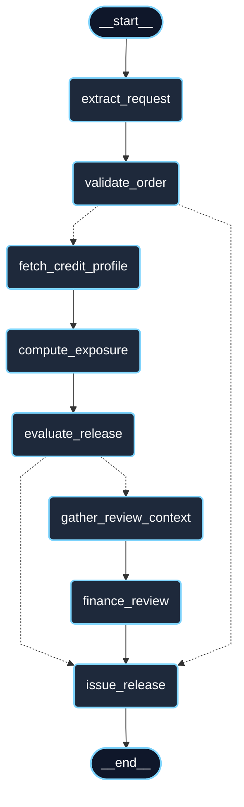
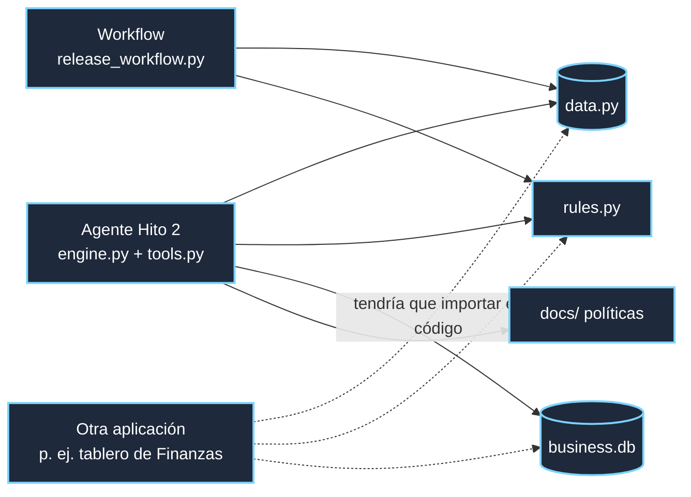
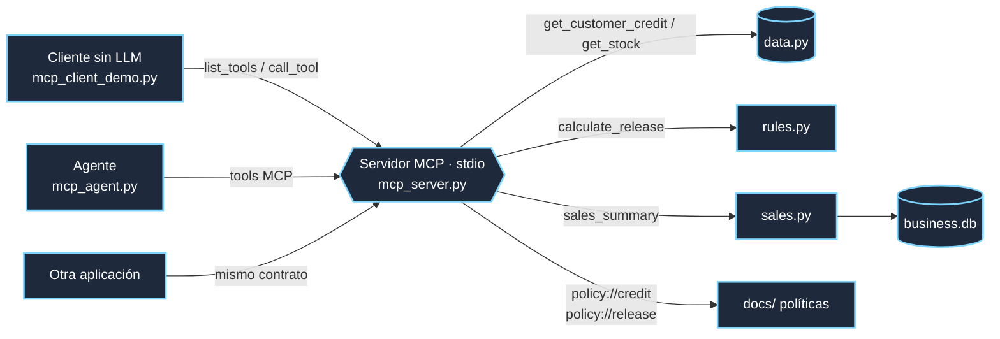

# Evidencias

Caso **CRE-008** | Variante **Crédito** | Semilla **2135**

- **Parte 1 · Evidencia de proceso y aprendizaje:** los 8 puntos de la sección 11 del enunciado.
- **Parte 2 · Pruebas mínimas:** los componentes de la sección 12. Los que ya se muestran en la Parte 1 se citan, no se repiten.
- **Anexo · Evidencia de los hitos:** lo que piden los recuadros de evidencia de cada hito y no entra en las partes anteriores.

En `HITOS.md`, cada hito indica qué secciones de este archivo lo demuestran.

Proveedor: `Google Gemini`. Modelo: `gemini-3.1-flash-lite`. Embeddings: `gemini-embedding-001`.

Las líneas de parámetros de la semilla (CASO_ID, límite, exposición y monto de revisión) se imprimen al inicio de cada ejecución; se omiten en las salidas para abreviar. Se ven completas en A.1 y A.6.

# Parte 1 · Evidencia de proceso y aprendizaje

## 1.1 Commits que muestran evolución real

El historial completo está en `git_log.txt`. Hay un commit por hito y, entre ellos, correcciones que salieron al probar, como la restauración de `.env.example` después de haberlo borrado.

| Hito | Commit |
|---|---|
| 1 | `18f7701` Hito 1: datos, semilla y reglas de liberacion de venta |
| 2 | `d7363f9` Hito 2: router, RAG, SQL y tools |
| 3 | `3c220bc` Hito 3: Workflow con estado |
| 4 | `8db68f6` Hito 4: Robustez: retry, checkpoint y Human-in-the-Loop |
| 5 | `878de3a` Hito 5: servidor MCP, cliente sin LLM y agente consumidor |
| 6 | Último commit de `git_log.txt` |

## 1.2 Error introducido durante el desarrollo y cómo se corrigió

Al integrar el workflow síncrono en `main.py`, que es asíncrono, el paso de liberación del caso end-to-end falló:

```
RuntimeError: AgentRunner.run_sync() cannot be called when an event loop is already running
```

Corrección: `main.py` ejecuta el workflow con `asyncio.to_thread`. El paso 4 del caso end-to-end (A.6) ahora se pausa y reanuda sin error. Cómo se detectó y qué otros errores hubo: `HITOS.md`, "Qué falló" de cada hito.

## 1.3 Ejecución con fallo técnico y retry

```
> SIMULATE_CREDIT_TIMEOUT=1 uv run python workflow_demo.py --thread-id caso3-retry --request "Libera 4 KRN-900X para C-1003"
id_hilo: caso3-retry
[fetch_credit_profile] attempt 1 for C-1003
[fetch_credit_profile] simulated transient failure: credit service timeout
[fetch_credit_profile] attempt 2 for C-1003

=== WORKFLOW FINISHED ===
Order released for C-1003: 4 x KRN-900X | amount USD 9,802.00 | available credit after order USD 10,198.00.
status: released
```

### Servicio de crédito caído en los 3 intentos

```
id_hilo: fix2
[fetch_credit_profile] attempt 1 for C-1003
[fetch_credit_profile] attempt 2 for C-1003
[fetch_credit_profile] attempt 3 for C-1003

Credit service unavailable after 3 attempts. The order is saved in id_hilo 'fix2'; try again later.
```

Estado guardado después del fallo: `next = ('fetch_credit_profile',)`.

| Prueba | Qué comprueba |
|---|---|
| `test_transient_credit_failure_is_retried` | Un fallo transitorio → 2 intentos → liberado |
| `test_credit_service_down_keeps_order_at_failed_node` | Servicio caído → 3 intentos, `TimeoutError`, pedido guardado en `fetch_credit_profile` |

## 1.4 Regla de negocio rechazada sin retry

Con el mismo fallo simulado activo:

```
> SIMULATE_CREDIT_TIMEOUT=1 uv run python workflow_demo.py --thread-id caso4-negocio --request "Libera 15 CYC-3DX para C-1003"
id_hilo: caso4-negocio

=== WORKFLOW FINISHED ===
Order rejected: Insufficient stock: requested 15, available 14.
status: rejected
```

No aparece ningún `[fetch_credit_profile] attempt`: el rechazo lo decide una regla en `validate_order`, el pedido nunca llega al servicio de crédito y no hay nada que reintentar. Contrasta con 1.3, que tiene la misma variable de fallo activa.

Resultados de `calculate_release` (`rules.py`) con los datos de la semilla:

| Llamada | decision | Motivo |
|---|---|---|
| `calculate_release("C-1003", "KRN-900X", 4)` | RELEASE | — |
| `calculate_release("C-1003", "KRN-900X", 7)` | REVIEW | Pedido de 17 153,50 alcanza el monto de revisión |
| `calculate_release("C-1003", "KRN-900X", 9)` | REVIEW | Línea insuficiente y monto de revisión |
| `calculate_release("C-1003", "CYC-3DX", 15)` | REJECT | Stock insuficiente (14 disponibles) |
| `calculate_release("C-9999", "NXS-G10", 1)` | REVIEW | Cliente en hold |
| `calculate_release("C-1010", "TTN-M40", 6)` | REVIEW | Solo monto de revisión (19 263,60) |

| Prueba | Qué comprueba |
|---|---|
| `test_business_rejection_is_not_retried` | Rechazo por stock → 0 intentos al servicio de crédito |
| Stock insuficiente: 15 CYC-3DX | `rejected`, sin `credit_status` en el State: no consultó crédito |

## 1.5 Pausa y reanudación con el mismo `id_hilo`

### Flujo pausado

```
> uv run python workflow_demo.py --thread-id caso1-pausa --request "Libera 9 KRN-900X para C-1003"
id_hilo: caso1-pausa
[fetch_credit_profile] attempt 1 for C-1003

=== FLOW PAUSED: WAITING FOR FINANCE / CREDIT ===
{'type': 'sale_release_credit_exception',
 'customer_id': 'C-1003',
 'credit_status': 'ok',
 'order': '9 x KRN-900X = USD 22,054.50',
 'credit_limit_usd': 30000,
 'current_exposure_usd': 10000,
 'available_credit_usd': 20000.0,
 'projected_exposure_usd': 32054.5,
 'projected_utilization_pct': 106.8,
 'reasons': ['Insufficient credit line: exposure + order = 32,054.50 exceeds '
             'limit 30,000.00.',
             'Order of 22,054.50 reaches review amount 15,000.00.'],
 'question': '¿Aprueba Finanzas liberar este pedido como excepcion?'}

Resume with the SAME --thread-id and --resume approve|reject
```

### Reanudación aprobada

```
> uv run python workflow_demo.py --thread-id caso1-pausa --resume approve --reviewer ana.finanzas --comment "Buen historial de pago"
id_hilo: caso1-pausa
Resuming with Finance answer: {'decision': 'approve', 'reviewer': 'ana.finanzas', 'comment': 'Buen historial de pago'}

=== WORKFLOW FINISHED ===
Order released by exception for C-1003: 9 x KRN-900X | amount USD 22,054.50 | reviewer: ana.finanzas. Comment: Buen historial de pago
status: released_by_exception
```

### Reanudación rechazada

Pedido de 7 KRN-900X para C-1003: pausa solo por monto de revisión (17 153,50 ≥ 15 000), sin problema de línea.

```
> uv run python workflow_demo.py --thread-id caso2-rechazo --request "Libera 7 KRN-900X para C-1003"
=== FLOW PAUSED: WAITING FOR FINANCE / CREDIT ===
 'reasons': ['Order of 17,153.50 reaches review amount 15,000.00.'],

> uv run python workflow_demo.py --thread-id caso2-rechazo --resume reject --reviewer ana.finanzas --comment "Supera el monto sin respaldo"
=== WORKFLOW FINISHED ===
Order rejected by Finance for C-1003: 7 x KRN-900X | amount USD 17,153.50 | reviewer: ana.finanzas. Comment: Supera el monto sin respaldo
status: rejected_by_finance
```

### Desde el punto de entrada (`main.py`)

El router elige la ruta `release` y se reanuda con el mismo `id_hilo`:

```
> uv run python main.py --thread-id main-01 "Libera 7 KRN-900X para C-1003"
  "route": "release",
id_hilo: main-01
=== FLOW PAUSED: WAITING FOR FINANCE / CREDIT ===
 'reasons': ['Order of 17,153.50 reaches review amount 15,000.00.'],
 'sources': ['[RULES:rules.py]',
             '[SQL:sales]',
             '[RAG:credit_policy.md#Monto de revisión]',
             '[RAG:credit_policy.md#Política de crédito]'],
Resume with the SAME id_hilo ('main-01') and --resume approve|reject

> uv run python main.py --thread-id main-01 --resume reject --reviewer ana.finanzas
=== WORKFLOW FINISHED ===
Order rejected by Finance for C-1003: 7 x KRN-900X | amount USD 17,153.50 | reviewer: ana.finanzas. Sources: [RULES:rules.py], [SQL:sales], [RAG:credit_policy.md#Monto de revisión], [RAG:credit_policy.md#Política de crédito]
status: rejected_by_finance

> uv run python main.py --resume approve
--resume needs the --thread-id (id_hilo) of the paused release.

> uv run python main.py "¿Puedo liberar el pedido?"
  "route": "clarify",
  "answer": "¿Que cliente, SKU y cantidad debo considerar?",
```

La fuente `[RAG:credit_policy.md#Política de crédito]` es solo el título del documento (limitación registrada en `HITOS.md`, Hito 6).

### Controles de `id_hilo`

| Situación | Salida |
|---|---|
| Reanudar con un `id_hilo` sin pedido pausado (`credito-nuevo-999`) | `No paused release found for id_hilo 'credito-nuevo-999'. Nothing to resume.` |
| Reanudar un `id_hilo` ya terminado (`credito-001`) | `No paused release found for id_hilo 'credito-001'. Nothing to resume.` |
| Nueva solicitud en un `id_hilo` con pedido pausado (`fix1`) | `id_hilo 'fix1' has an order waiting for Finance. Resume it with --resume approve\|reject or use another --thread-id.` |

Tras el tercer caso, `--resume reject` sobre `fix1` cerró el pedido original (C-1003, 9 unidades): no fue reemplazado.

Sin el control, reanudar con un `id_hilo` sin pausa terminaba así:

```
KeyError: 'request_text'
During task with name 'extract_request'
```

| Prueba (`tests/test_release_workflow.py`) | Qué comprueba |
|---|---|
| `test_review_route_pauses_with_credit_memo` | El flujo se detiene en `finance_review` con el memo |
| `test_resume_approve_releases_by_exception` | Aprobar → `released_by_exception`, con revisor |
| `test_resume_reject_rejects_by_finance` | Rechazar → `rejected_by_finance` |
| `test_invalid_finance_answer_pauses_again` | La respuesta `"no"` vuelve a pausar con error; luego acepta una válida |

## 1.6 Router que se equivoca o tiene baja confianza

`uv run python benchmark.py`

```
DETERMINISTIC
OK   expected=rag     got=rag     conf=0.95 | ¿Qué dice la política sobre venderle a un cliente en hold?
OK   expected=rag     got=rag     conf=0.95 | ¿Quién debe aprobar un pedido que supera el monto de revisión?
OK   expected=sql     got=sql     conf=0.95 | ¿Cuánto le hemos facturado a C-1003 en 2026?
OK   expected=sql     got=sql     conf=0.95 | ¿Cuántas unidades de KRN-900X vendimos este año?
OK   expected=tools   got=tools   conf=0.92 | ¿Cuánto nos debe actualmente C-1003?
OK   expected=tools   got=tools   conf=0.92 | ¿Hay stock de CYC-3DX?
OK   expected=release got=release conf=0.92 | Libera 4 KRN-900X para C-1003
OK   expected=release got=release conf=0.92 | Libera 9 KRN-900X para C-1003
OK   expected=release got=release conf=0.92 | Libera 15 CYC-3DX para C-1003
OK   expected=clarify got=clarify conf=0.95 | ¿Puedo liberar el pedido?
FAIL expected=direct  got=tools   conf=0.92 | ¿Explica que es la exposición crediticia?
OK   expected=direct  got=direct  conf=0.55 | ¿Por qué las empresas B2B venden a plazo?
deterministic: accuracy=92% | 0.00s
MODEL
OK   expected=rag     got=rag     conf=1.00 | ¿Qué dice la política sobre venderle a un cliente en hold?
OK   expected=rag     got=rag     conf=1.00 | ¿Quién debe aprobar un pedido que supera el monto de revisión?
OK   expected=sql     got=sql     conf=1.00 | ¿Cuánto le hemos facturado a C-1003 en 2026?
OK   expected=sql     got=sql     conf=1.00 | ¿Cuántas unidades de KRN-900X vendimos este año?
OK   expected=tools   got=tools   conf=1.00 | ¿Cuánto nos debe actualmente C-1003?
OK   expected=tools   got=tools   conf=1.00 | ¿Hay stock de CYC-3DX?
OK   expected=release got=release conf=1.00 | Libera 4 KRN-900X para C-1003
OK   expected=release got=release conf=1.00 | Libera 9 KRN-900X para C-1003
OK   expected=release got=release conf=1.00 | Libera 15 CYC-3DX para C-1003
OK   expected=clarify got=clarify conf=1.00 | ¿Puedo liberar el pedido?
OK   expected=direct  got=direct  conf=1.00 | ¿Explica que es la exposición crediticia?
OK   expected=direct  got=direct  conf=1.00 | ¿Por qué las empresas B2B venden a plazo?
model: accuracy=100% | 14.29s
HYBRID
OK   expected=rag     got=rag     conf=0.95 | ¿Qué dice la política sobre venderle a un cliente en hold?
OK   expected=rag     got=rag     conf=0.95 | ¿Quién debe aprobar un pedido que supera el monto de revisión?
OK   expected=sql     got=sql     conf=0.95 | ¿Cuánto le hemos facturado a C-1003 en 2026?
OK   expected=sql     got=sql     conf=0.95 | ¿Cuántas unidades de KRN-900X vendimos este año?
OK   expected=tools   got=tools   conf=0.92 | ¿Cuánto nos debe actualmente C-1003?
OK   expected=tools   got=tools   conf=0.92 | ¿Hay stock de CYC-3DX?
OK   expected=release got=release conf=0.92 | Libera 4 KRN-900X para C-1003
OK   expected=release got=release conf=0.92 | Libera 9 KRN-900X para C-1003
OK   expected=release got=release conf=0.92 | Libera 15 CYC-3DX para C-1003
OK   expected=clarify got=clarify conf=0.95 | ¿Puedo liberar el pedido?
FAIL expected=direct  got=tools   conf=0.92 | ¿Explica que es la exposición crediticia?
OK   expected=direct  got=direct  conf=1.00 | ¿Por qué las empresas B2B venden a plazo?
hybrid: accuracy=92% | 2.31s
```

| Router | Precisión | Error |
|---|---|---|
| Por reglas | 92 % | Caso 11 ("exposición crediticia" → `tools`) |
| Por modelo | 100 % | Ninguno en esta ejecución |
| Híbrido | 92 % | Caso 11, igual que las reglas |

**Error: caso 11, router por reglas e híbrido.** La consulta contiene "exposicion", que es palabra clave de tools, y la regla de tools se revisa antes que la de preguntas conceptuales. Además empieza con "¿", así que tampoco calza con `startswith("explica")`. La regla responde con confianza 0,92, mayor que el umbral de 0,90, y el híbrido no consulta al modelo.

**Error: caso 10, router por modelo (ejecución anterior).** Antes de existir la ruta `release`, el mismo modelo mandó "¿Puedo liberar el pedido?" a `tools`, aunque no tiene cliente ni SKU. En el híbrido ganó la regla (confianza 0,95), así que el error no llegó al usuario. Esa vez la precisión fue de 92 % en los tres routers y el router por modelo tardó 137 s.

**Baja confianza: caso 12.** Ninguna regla aplica, la regla queda en `direct` con 0,55 y el híbrido consulta al modelo, que confirma `direct`. Es el único caso donde el híbrido usa el modelo.

## 1.7 Decisión que cambiaría en producción

Hoy, cualquiera que ejecute `--resume approve` libera una excepción de crédito. `FinanceDecision` exige un revisor y una decisión explícita, pero el revisor es un nombre escrito, no un usuario verificado. En producción, Finanzas aprobaría desde su propia aplicación, con usuarios autenticados, y el sistema verificaría que quien aprueba tenga permiso para ese monto y ese tipo de excepción.

Es el mayor riesgo del diseño actual (`HITOS.md`, Hito 6). Las demás decisiones y lo que cambiaría en cada una están en `DECISIONES.md`, apartado "En producción".

## 1.8 La IA sugirió algo incorrecto y se corrigió

Al proponer las reglas, la IA recomendó tratar al cliente en hold como **rechazo directo**. La tabla de la sección 04 del enunciado lo pone como excepción para Finanzas / crédito. Se detectó al pedirle que revisara todas sus propuestas contra el enunciado, y se corrigió antes de programar: un cliente en hold pasa a revisión.

```
calculate_release("C-9999", "NXS-G10", 1)  ->  REVIEW: Customer is on credit hold.
```

Los demás errores de la IA, con cómo se detectó y corrigió cada uno, están en `USO_IA.md`.

# Parte 2 · Pruebas mínimas

| Componente | Prueba requerida | Dónde |
|---|---|---|
| Router | 12 casos | 1.6 |
| RAG | 3 consultas, incluida una que no debe usar RAG | 2.1 |
| SQL | 3 consultas | 2.2 |
| Workflow | Ruta directa, ruta HITL, aprobar y rechazar | 2.4 (ruta directa) y 1.5 (HITL, aprobar y rechazar) |
| Retry | Error técnico transitorio simulado | 1.3 |
| Regla de negocio | Bloqueada sin retry | 1.4 |
| MCP | `list_tools` + `call_tool` sin LLM | 2.5 |
| Agente MCP | Una consulta compuesta | 2.6 |
| Datos inválidos | SKU o cliente inexistente | 2.7 |
| Solicitud ambigua | Aclarar o detener ejecución segura | 2.8 |

Tools (2.3) no está en la tabla de la sección 12, pero lo pide la evidencia del Hito 2.

## 2.1 RAG: 3 consultas, una que no usa RAG

| Consulta | Ruta | Primer resultado | Score |
|---|---|---|---|
| ¿Qué dice la política sobre venderle a un cliente en hold? | rag | `[RAG:credit_policy.md#Clientes en hold]` | 0,7925 |
| ¿Quién debe aprobar un pedido que supera el monto de revisión? | rag | `[RAG:credit_policy.md#Monto de revisión]` | 0,8076 |
| ¿Hay stock de CYC-3DX? | **tools: no usa RAG** | — (responde `get_stock`: 14 unidades) | — |

Respuesta del agente a la primera consulta (`uv run python main.py`):

```
"answer": "La política establece que un cliente con estado de crédito 'hold' se encuentra bloqueado. En esta situación, no es posible liberar pedidos de forma automática; cualquier pedido realizado por un cliente en este estado debe pasar obligatoriamente por una revisión del equipo de Finanzas o Crédito, quienes determinarán si se aprueba una excepción.",
"facts": [
  "Un cliente con estado de crédito 'hold' está bloqueado [RAG:credit_policy.md#Clientes en hold].",
  ...
  "La verificación de que el cliente no esté en 'hold' es uno de los pasos previos para la liberación automática de un pedido [RAG:release_policy.md#Pasos para liberar un pedido]."
]
```

## 2.2 SQL: 3 consultas (`tests/test_tools.py`)

| Prueba | Llamada | Resultado |
|---|---|---|
| Facturación por cliente y año | `sales_summary(customer_id="C-1003", year=2026)` | 4 ventas, 28 559,80 USD |
| Unidades por SKU | `sales_summary(sku="KRN-900X")` | 5 unidades, `source_ref` `[SQL:sales]` |
| Año sin ventas | `sales_summary(customer_id="C-1003", year=2025)` | 0 ventas, sin error |

Respuesta del agente a "¿Cuánto le hemos facturado a C-1003 en 2026?": ruta `sql`, "La facturación total para el cliente C-1003 en el año 2026 es de 28,559.80 USD", con la fuente `[SQL:sales]`.

## 2.3 Tools: 4 pruebas (`tests/test_tools.py`)

Lo pide la evidencia del Hito 2 (3 pruebas de tools).

| Prueba | Llamada | Resultado |
|---|---|---|
| Línea disponible | `get_customer("C-1003")` | `available_credit_usd` = 20 000 |
| Cliente inexistente | `get_customer("C-0000")` | `ok: false`, `not_found`, recuperable |
| Revisión por monto | `calculate_release("C-1003", "KRN-900X", 7)` | `REVIEW`, un solo motivo |
| Stock insuficiente | `calculate_release("C-1003", "CYC-3DX", 15)` | `REJECT` |

La respuesta del agente por la ruta `tools`, ya conectado por MCP, está en el paso 3 del caso end-to-end (A.6).

## 2.4 Workflow: ruta directa y otras salidas

La ruta HITL, aprobar y rechazar están en 1.5.

### Ruta directa

```
> uv run python workflow_demo.py
CASO_ID=CRE-008 | VARIANT=Credit | SEMILLA=2135
Main customer: C-1003
  credit limit     : USD 30,000
  current exposure : USD 10,000
Review amount      : USD 15,000

=== WORKFLOW FINISHED ===
Order released for C-1003: 4 x KRN-900X | amount USD 9,802.00 | available credit after order USD 10,198.00.
status: released
```

Recorrido: `extract_request → validate_order → fetch_credit_profile → compute_exposure → evaluate_release → issue_release`. No pasa por `finance_review`. Con la misma semilla y la misma solicitud, el resultado es siempre el mismo.

### Otras salidas

| Solicitud (`--request`) | Recorrido | Resultado |
|---|---|---|
| Libera 15 CYC-3DX para C-1003 | `validate_order` → `issue_release` (sin consultar crédito) | `rejected`: stock insuficiente (14 disponibles) |
| Libera el pedido de C-1003 por favor | `extract_request` → `validate_order` → `issue_release` | `blocked`: faltan SKU y cantidad |

### Pruebas automáticas (`tests/test_release_workflow.py`)

El extractor se reemplaza por uno fijo y el checkpoint por uno en memoria: no se usa el LLM ni se crean archivos.

| Prueba | Qué comprueba |
|---|---|
| Ruta directa: 4 KRN-900X para C-1003 | `RELEASE`, `released`, línea disponible 20 000 |
| Aristas condicionales | Cada valor de `status` y `decision` va al nodo esperado |
| `test_review_memo_includes_sales_history_and_policy` | El memo incluye la facturación de C-1003 (28 559,80) y las fuentes reglas, SQL y RAG |
| `test_policy_lookup_failure_does_not_block_review` | Si la búsqueda de política falla, el pedido igual llega a Finanzas, sin esa fuente |
| `test_context_does_not_change_the_decision` | Después del contexto, `decision` sigue en `REVIEW` y la respuesta final cita las fuentes |

## 2.5 MCP: `list_tools` + `call_tool` sin LLM

```
> uv run python mcp_client_demo.py
=== MCP CONNECTION (stdio) ===
protocol: 2026-07-28

=== list_tools ===
- get_customer_credit: Credit profile of a customer: status, credit limit, current exposure and available credit.
- get_stock: Current available stock of a known SKU.
- calculate_release: Release decision for an order: RELEASE, REVIEW (Finance) or REJECT. Read-only: approves nothing.
- sales_summary: Historical sales with optional filters (SKU, customer, year). Fixed parameterized SQL.

=== call_tool get_stock(KRN-900X) ===
{'ok': True, 'sku': 'KRN-900X', 'available_units': 45, 'source': 'inventory'}

=== call_tool get_customer_credit(C-1003) ===
{'ok': True, 'customer_id': 'C-1003', 'credit_status': 'ok', 'credit_limit_usd': 30000, 'current_exposure_usd': 10000, 'available_credit_usd': 20000.0, 'source': 'credit_service'}

=== call_tool calculate_release(C-1003, KRN-900X, 9) ===
{'ok': True, 'decision': 'REVIEW', 'order_amount_usd': 22054.5, 'reasons': ['Insufficient credit line: exposure + order = 32,054.50 exceeds limit 30,000.00.', 'Order of 22,054.50 reaches review amount 15,000.00.']}

=== list_resources ===
- policy://credit
- policy://release

=== read_resource policy://credit ===
# Política de crédito

## Clientes en hold
Un cliente con estado de crédito hold está bloqueado. Ningún pedido de un cliente en hold se libera de forma automática: ...
```

### Pruebas automáticas (`tests/test_mcp.py`)

Cada prueba levanta el servidor real por stdio y usa un cliente sin LLM.

| Prueba | Resultado |
|---|---|
| `list_tools` | Exactamente `get_customer_credit`, `get_stock`, `calculate_release` y `sales_summary` |
| `call_tool calculate_release` | 9 KRN-900X para C-1003 → `REVIEW` con 2 motivos |
| `call_tool get_customer_credit` | Línea disponible 20 000, sin la ficha completa (no incluye el nombre) |
| Cliente inexistente | `ok: false` |
| `call_tool sales_summary` | C-1003 en 2026: 28 559,80 |
| Resources | Solo `policy://credit` y `policy://release`; la política de crédito se lee completa |

## 2.6 Agente MCP: una consulta compuesta

```
> uv run python mcp_agent.py
Query: Revisa la linea de credito de C-1003, el stock de KRN-900X y si se puede liberar un pedido de 9 unidades de KRN-900X para C-1003.

=== AGENT + MCP ===
{
  "answer": "El pedido no puede ser liberado automáticamente en este momento. Debido a que el monto del pedido (22,054.50 USD) supera el límite de crédito disponible, la solicitud ha sido marcada como REVIEW y debe ser revisada por el departamento de Finanzas y Crédito.",
  "facts": [
    "Estado de crédito del cliente C-1003: OK (Límite: 30,000 USD, Exposición actual: 10,000 USD, Crédito disponible: 20,000 USD).",
    "Stock actual del SKU KRN-900X: 45 unidades.",
    "Decisión de liberación: REVIEW.",
    "Motivos de revisión: El monto del pedido (22,054.50 USD) excede el crédito disponible y supera el límite de revisión establecido (15,000 USD)."
  ],
  "warnings": [
    "La suma de la exposición actual y el nuevo pedido (32,054.50 USD) excede el límite total de crédito del cliente (30,000 USD)."
  ]
}
```

### Misma capacidad, dos consumidores

| Consumidor | Llamada | Decisión | Motivos |
|---|---|---|---|
| Cliente sin LLM | `calculate_release(C-1003, KRN-900X, 9)` | `REVIEW` | Línea insuficiente (32 054,50 > 30 000) y monto de revisión (22 054,50 ≥ 15 000) |
| Agente | La misma tool, elegida por el modelo | `REVIEW` | Los mismos dos motivos |

La decisión la toma `rules.py` dentro del servidor; el agente solo la reporta.

### Cada ruta ve solo sus tools MCP

Conexión al servidor con el filtro de cada ruta, sin LLM:

```
sql ['sales_summary']
tools ['get_customer_credit', 'get_stock']
```

## 2.7 Datos inválidos: SKU o cliente inexistente

| Dónde | Entrada | Resultado |
|---|---|---|
| `rules.py` | `calculate_release("C-0000", "KRN-900X", 1)` | error `not_found`: cliente no encontrado |
| `rules.py` | `calculate_release("C-1003", "XXX", 1)` | error `not_found`: SKU no encontrado |
| `rules.py` | `calculate_release("C-1003", "KRN-900X", 0)` | error `invalid_quantity` |
| Tool | `get_customer("C-0000")` | `ok: false`, `not_found`, recuperable |
| Workflow | Cliente inexistente | `rejected`, motivo "Customer not found", sin consultar crédito |
| MCP | `get_customer_credit` con cliente inexistente | `ok: false` |

## 2.8 Solicitud ambigua: aclarar o detener la ejecución

| Dónde | Entrada | Resultado |
|---|---|---|
| Router | "¿Puedo liberar el pedido?" | Ruta `clarify`: responde "¿Que cliente, SKU y cantidad debo considerar?" sin crear el agente ni llamar a ninguna tool (salida en 1.5, "Desde el punto de entrada") |
| Workflow | "Libera el pedido de C-1003 por favor" | `blocked`: faltan SKU y cantidad; no se evalúa ningún pedido |
| Workflow | Respuesta de Finanzas inválida (`"no"`) | Vuelve a pausar con el error; nunca aprueba por defecto (`test_invalid_finance_answer_pauses_again`) |
| `main.py` | `--resume approve` sin `--thread-id` | `--resume needs the --thread-id (id_hilo) of the paused release.` |

## 2.9 Todas las pruebas automáticas

Ninguna usa el LLM.

| Archivo | Pruebas | Qué cubre |
|---|---|---|
| `tests/test_router.py` | 7 | Router por reglas, incluida la ruta `release` |
| `tests/test_tools.py` | 7 | SQL y tools |
| `tests/test_release_workflow.py` | 15 | Rutas, pausa, reanudación, retry, servicio caído y contexto para Finanzas |
| `tests/test_mcp.py` | 6 | Servidor MCP por stdio, sin LLM |

```
> uv run pytest
35 passed
```

# Anexo · Evidencia de los hitos

## A.1 Escenario de la semilla y datos mínimos (Hito 1)

```
> python case_config.py
CASO_ID=CRE-008 | VARIANT=Credit | SEMILLA=2135
Main customer: C-1003
  credit limit     : USD 30,000
  current exposure : USD 10,000
Review amount      : USD 15,000
```

Al ejecutarlo dos veces se obtienen los mismos valores. C-1003 tiene 20 000 USD de línea disponible.

| Dato | Dónde está | Contenido |
|---|---|---|
| Clientes | `data.py` → `CUSTOMERS` | C-1003 (caso principal, valores de la semilla), C-1010 (línea holgada: 120 000 / 20 000), C-9999 (en hold) |
| Productos | `data.py` → `PRODUCTS` | KRN-900X, NXS-G10, OPT-V300, CYC-3DX, TTN-M40 |
| Inventario | `data.py` → `STOCK` | 45, 120, 62, 14 y 35 unidades respectivamente |
| Ventas | `data/business.db`, tabla `sales` (se crea con `python bootstrap_db.py`) | 9 ventas de 2026 repartidas entre los 3 clientes |

Primer commit funcional de datos y reglas: `18f7701` (ver `git_log.txt`).

## A.2 Tabla consulta → capacidad esperada → justificación (Hito 1)

| # | Consulta | Capacidad esperada | Resultado esperado | Justificación |
|---|---|---|---|---|
| 1 | ¿Qué dice la política sobre venderle a un cliente en hold? | RAG | Cita la política de crédito | Es una regla escrita en un documento. La respuesta tiene que salir del texto de la política y citar la fuente; no es un dato que esté en una tabla. |
| 2 | ¿Quién debe aprobar un pedido que supera el monto de revisión? | RAG | Cita la política de crédito | Pregunta por un procedimiento (quién aprueba), que es información documental. Lo que se necesita es encontrar el párrafo correcto de la política, no calcular nada. |
| 3 | ¿Cuánto le hemos facturado a C-1003 en 2026? | SQL | Total de ventas históricas de C-1003 | Es una suma sobre varias ventas pasadas. El total tiene que salir de una consulta parametrizada a la tabla `sales`; un RAG no suma montos y un LLM podría inventar la cifra. |
| 4 | ¿Cuántas unidades de KRN-900X vendimos este año? | SQL | Unidades agregadas de KRN-900X | Agregación sobre el historial filtrada por SKU. Igual que la 3: dato transaccional que se calcula con SQL. |
| 5 | ¿Cuánto nos debe actualmente C-1003? | Tool | Exposición actual: 10 000 | Parece una pregunta de historia (SQL) por la palabra "debe", pero lo que pide es el saldo de hoy, que es un dato operacional del cliente. Se consulta con una tool del cliente. La dejé a propósito porque es fácil clasificarla mal. |
| 6 | ¿Hay stock de CYC-3DX? | Tool | 14 unidades | El stock cambia con cada venta. Se consulta en el momento con una tool; no puede estar en un documento ni en el prompt. |
| 7 | Libera 4 KRN-900X para C-1003 | Regla | RELEASE | El pedido es 9 802 USD; con la exposición queda en 19 802, bajo el límite de 30 000, y no llega al monto de revisión de 15 000. Son comparaciones de números, así que las resuelve `calculate_release` en Python. |
| 8 | Libera 9 KRN-900X para C-1003 | Regla | REVIEW: insufficient credit line | El pedido es 22 054,50 USD; la exposición quedaría en 32 054,50 y supera el límite de 30 000. La regla lo detecta y el pedido pasa a revisión de Finanzas. Un LLM no debe decidir si 32 054,50 es mayor que 30 000. |
| 9 | Libera 15 CYC-3DX para C-1003 | Regla | REJECT: insufficient stock | Hay 14 unidades y se piden 15. Se rechaza antes de mirar el crédito, porque no tiene sentido pedir aprobación para algo que no se puede despachar. |
| 10 | ¿Puedo liberar el pedido? | Aclaración | Pedir cliente, producto y cantidad | No dice qué cliente, qué producto ni cuántas unidades. Sin esos datos no se puede aplicar ninguna regla, así que lo correcto es preguntar en vez de suponer. |

## A.3 Diagrama del workflow (Hitos 3 y 6)

Generado desde el grafo con `uv run python workflow_demo.py --diagram`. Las flechas punteadas son aristas condicionales. En el Hito 3 el grafo tenía 7 nodos; `gather_review_context` se agregó en el Hito 6 para sumar al memo el historial de ventas (SQL) y la política aplicable (RAG) antes de la pausa.



## A.4 Campos del State (Hitos 3, 4 y 6)

`ReleaseState` en `release_state.py`. Hito 3: 14 campos; Hito 4: los tres de Finanzas; Hito 6: los dos de contexto.

| Campo | Lo escribe | Para qué sirve |
|---|---|---|
| `request_text` | Entrada | El texto original de la solicitud; lo lee el extractor |
| `customer_id` | `extract_request` | Cliente del pedido |
| `sku` | `extract_request` | Producto del pedido |
| `quantity` | `extract_request` | Unidades del pedido |
| `order_amount_usd` | `validate_order` | Precio × cantidad. Es el monto que comparan las reglas de línea y de monto de revisión |
| `credit_status` | `fetch_credit_profile` | `ok` o `hold` |
| `credit_limit_usd` | `fetch_credit_profile` | Límite de crédito del cliente (para C-1003 viene de la semilla) |
| `current_exposure_usd` | `fetch_credit_profile` | Lo que el cliente ya debe (para C-1003 viene de la semilla) |
| `available_credit_usd` | `compute_exposure` | Límite − exposición. Es lo primero que mira Finanzas |
| `projected_exposure_usd` | `compute_exposure` | Exposición + pedido. Es el valor que la regla compara con el límite |
| `decision` | `validate_order` o `evaluate_release` | `RELEASE`, `REVIEW` o `REJECT`. Controla la segunda arista condicional |
| `reasons` | `validate_order` o `evaluate_release` | Motivos legibles de la decisión |
| `status` | Todos los nodos | En qué etapa va el pedido. Controla la primera arista condicional y el mensaje final |
| `message` | `extract_request` o `issue_release` | Respuesta final para el usuario |
| `finance_decision` | `finance_review` | `approve` o `reject`: lo que decidió Finanzas / crédito |
| `reviewer` | `finance_review` | Quién aprobó o rechazó la excepción |
| `finance_comment` | `finance_review` | Motivo dado por Finanzas (opcional) |
| `sales_history` | `gather_review_context` | Transacciones, unidades y facturación del cliente (SQL), para el memo de Finanzas |
| `policy_refs` | `gather_review_context` | Secciones de política aplicables (RAG), citadas en el memo y en la respuesta final |

`decision` no cambia después de la revisión: sigue en `REVIEW`. Es intencional. `decision` guarda lo que decidió la regla y `finance_decision` lo que decidió la **persona**; separados dejan registro de quién decidió qué. El resultado final del pedido se lee en `status`.

## A.5 Diagramas antes y después de MCP (Hito 5)

### Antes

Cada consumidor importa directamente los módulos de Python. Una aplicación nueva tendría que hacer lo mismo.



### Después

Los consumidores usan un contrato: tools y resources por stdio. Solo el servidor conoce los módulos internos.



## A.6 Caso completo reproducible (Hito 6)

`uv run python e2e_demo.py` ejecuta el caso completo de C-1003 por el mismo camino que `main.py`: el router elige la ruta y la consulta va al agente o al workflow. Cada ejecución usa un `id_hilo` nuevo, así que el caso se puede repetir. Router en modo híbrido.

| Paso | Consulta | Ruta | Componentes |
|---|---|---|---|
| 1 | ¿Qué dice la política sobre pedidos que superan el monto de revisión? | `rag` | Router → agente → RAG local |
| 2 | ¿Cuánto le hemos facturado a C-1003 en 2026? | `sql` | Router → agente → MCP (`sales_summary`) → SQL |
| 3 | ¿Cuánta línea de crédito disponible tiene C-1003 y cuánto stock hay de KRN-900X? | `tools` | Router → agente → MCP (`get_customer_credit`, `get_stock`) |
| 4 | Libera 9 KRN-900X para C-1003 | `release` | Router → workflow: LLM (extracción) → reglas → servicio de crédito con retry → contexto SQL y RAG → pausa |
| 5 | Finanzas aprueba con el mismo `id_hilo` | — | Reanudación desde el checkpoint |

Salida completa:

```
CASO_ID=CRE-008 | VARIANT=Credit | SEMILLA=2135
Main customer: C-1003
  credit limit     : USD 30,000
  current exposure : USD 10,000
Review amount      : USD 15,000
SQLite ready: D:\Agente-Modulo3\aguirre_andre_modulo3\data\business.db (9 sales)

##############################################################################
# 1. Policy (RAG)
# Query: ¿Qué dice la política sobre pedidos que superan el monto de revisión?
##############################################################################

=== ROUTING ===
{
  "route": "rag",
  "confidence": 0.95,
  "reason": "Pregunta documental",
  "clarification_question": null
}

=== RESPONSE ===
{
  "answer": "La política establece que cualquier pedido cuyo monto sea igual o superior al monto de revisión vigente debe ser enviado a revisión por el equipo de Finanzas o Crédito, independientemente de si el cliente cuenta con línea de crédito disponible.",
  "facts": [
    "Todo pedido con un monto igual o superior al límite de revisión debe pasar por una revisión de Finanzas o Crédito [RAG:credit_policy.md#Monto de revisión].",
    "El monto de revisión vigente se define específicamente en la configuración del caso [RAG:credit_policy.md#Monto de revisión]."
  ],
  "warnings": [
    "El documento no especifica el valor numérico del monto de revisión, ya que se indica que este se define en la configuración del caso y no en la política general."
  ]
}

##############################################################################
# 2. Sales history (SQL via MCP)
# Query: ¿Cuánto le hemos facturado a C-1003 en 2026?
##############################################################################

=== ROUTING ===
{
  "route": "sql",
  "confidence": 0.95,
  "reason": "Pregunta historica/agregada",
  "clarification_question": null
}

=== RESPONSE ===
{
  "answer": "Durante el año 2026, la facturación total para el cliente C-1003 ha sido de 28,559.80 USD.",
  "facts": [
    "El cliente C-1003 realizó 4 transacciones en 2026.",
    "El volumen total de unidades vendidas fue de 21 unidades.",
    "El ingreso total generado es de 28,559.80 USD [SQL:sales]."
  ],
  "warnings": []
}

##############################################################################
# 3. Current credit and stock (tools via MCP)
# Query: ¿Cuánta línea de crédito disponible tiene C-1003 y cuánto stock hay de KRN-900X?
##############################################################################

=== ROUTING ===
{
  "route": "tools",
  "confidence": 0.92,
  "reason": "Dato operacional actual",
  "clarification_question": null
}

=== RESPONSE ===
{
  "answer": "El cliente C-1003 tiene una línea de crédito disponible de 20,000 USD y existen 45 unidades disponibles en stock del producto KRN-900X.",
  "facts": [
    "Estado de crédito del cliente C-1003: ok",
    "Límite de crédito del cliente C-1003: 30,000 USD",
    "Exposición actual del cliente C-1003: 10,000 USD",
    "Crédito disponible del cliente C-1003: 20,000 USD",
    "Stock actual del SKU KRN-900X: 45 unidades"
  ],
  "warnings": []
}

##############################################################################
# 4. Release request (workflow: rules, exception, pause)
# Query: Libera 9 KRN-900X para C-1003
##############################################################################

=== ROUTING ===
{
  "route": "release",
  "confidence": 0.92,
  "reason": "Solicitud de liberacion de venta",
  "clarification_question": null
}

id_hilo: e2e-742724cf
[fetch_credit_profile] attempt 1 for C-1003

=== FLOW PAUSED: WAITING FOR FINANCE / CREDIT ===
{'type': 'sale_release_credit_exception',
 'customer_id': 'C-1003',
 'credit_status': 'ok',
 'order': '9 x KRN-900X = USD 22,054.50',
 'credit_limit_usd': 30000,
 'current_exposure_usd': 10000,
 'available_credit_usd': 20000.0,
 'projected_exposure_usd': 32054.5,
 'projected_utilization_pct': 106.8,
 'reasons': ['Insufficient credit line: exposure + order = 32,054.50 exceeds '
             'limit 30,000.00.',
             'Order of 22,054.50 reaches review amount 15,000.00.'],
 'sales_history': {'transactions': 4, 'units': 21, 'revenue_usd': 28559.8},
 'sources': ['[RULES:rules.py]',
             '[SQL:sales]',
             '[RAG:credit_policy.md#Línea de crédito]',
             '[RAG:credit_policy.md#Monto de revisión]'],
 'question': '¿Aprueba Finanzas liberar este pedido como excepcion?'}

Resume with the SAME id_hilo ('e2e-742724cf') and --resume approve|reject

##############################################################################
# 5. Finance approves the exception (same id_hilo)
##############################################################################
id_hilo: e2e-742724cf
Resuming with Finance answer: {'decision': 'approve', 'reviewer': 'ana.finanzas', 'comment': 'Buen historial de pago'}

=== WORKFLOW FINISHED ===
Order released by exception for C-1003: 9 x KRN-900X | amount USD 22,054.50 | reviewer: ana.finanzas. Comment: Buen historial de pago Sources: [RULES:rules.py], [SQL:sales], [RAG:credit_policy.md#Línea de crédito], [RAG:credit_policy.md#Monto de revisión]
status: released_by_exception
```

Al terminar, Windows imprime un aviso de cierre (`OSError: [WinError 6]`) que no afecta los resultados (ver `HITOS.md`, Hito 6).
