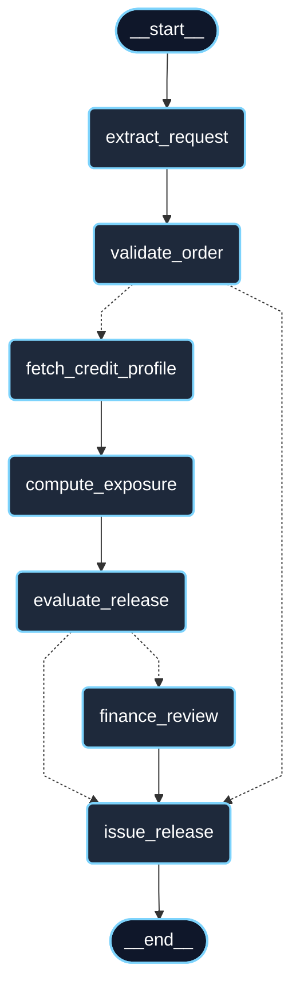

# Evidencias

Caso **CRE-008** · Variante **Crédito** · Semilla **2135**

## Hito 1 · Comprender y separar responsabilidades

### Escenario generado por la semilla

```
> python case_config.py
CASO_ID=CRE-008 | VARIANT=Credit | SEMILLA=2135
Main customer: C-1003
  credit limit     : USD 30,000
  current exposure : USD 10,000
Review amount      : USD 15,000
```

Al ejecutarlo dos veces se obtienen los mismos valores. C-1003 tiene 20 000 USD de línea disponible.

### Datos mínimos

| Dato | Dónde está | Contenido |
|---|---|---|
| Clientes | `data.py` → `CUSTOMERS` | C-1003 (caso principal, valores de la semilla), C-1010 (línea holgada: 120 000 / 20 000), C-9999 (en hold) |
| Productos | `data.py` → `PRODUCTS` | KRN-900X, NXS-G10, OPT-V300, CYC-3DX, TTN-M40 |
| Inventario | `data.py` → `STOCK` | 45, 120, 62, 14 y 35 unidades respectivamente |
| Ventas | `data/business.db`, tabla `sales` (se crea con `python bootstrap_db.py`) | 9 ventas de 2026 repartidas entre los 3 clientes |

### Tabla consulta → capacidad esperada → justificación

| # | Consulta | Capacidad esperada | Resultado esperado | Justificación |
|---|---|---|---|---|
| 1 | ¿Qué dice la política sobre venderle a un cliente en hold? | RAG | Cita la política de crédito | Es una regla escrita en un documento. La respuesta tiene que salir del texto de la política y citar la fuente; no es un dato que esté en una tabla. |
| 2 | ¿Quién debe aprobar un pedido que supera el monto de revisión? | RAG | Cita la política de crédito | Pregunta por un procedimiento (quién aprueba), que es información documental. Lo que se necesita es encontrar el párrafo correcto de la política, no calcular nada. |
| 3 | ¿Cuánto le hemos facturado a C-1003 en 2026? | SQL | Total de ventas históricas de C-1003 | Es una suma sobre varias ventas pasadas. El total tiene que salir de una consulta parametrizada a la tabla `sales`; un RAG no suma montos y un LLM podría inventar la cifra. |
| 4 | ¿Cuántas unidades de KRN-900X vendimos este año? | SQL | Unidades agregadas de KRN-900X | Agregación sobre el historial filtrada por SKU. Igual que la 3: dato transaccional que se calcula con SQL. |
| 5 | ¿Cuánto nos debe actualmente C-1003? | Tool | Exposición actual: 10 000 | Parece una pregunta de historia (SQL) por la palabra "debe", pero lo que pide es el saldo de hoy, que es un dato operacional del cliente. Se consulta con una tool del cliente. La dejé a propósito porque es fácil clasificarla mal. |
| 6 | ¿Hay stock de CYC-3DX? | Tool | 14 unidades | El stock cambia con cada venta. Se consulta en el momento con una tool; no puede estar en un documento ni en el prompt. |
| 7 | Libera 4 KRN-900X para C-1003 | Regla | RELEASE | El pedido es 9 802 USD; con la exposición queda en 19 802, bajo el límite de 30 000, y no llega al monto de revisión de 15 000. Son comparaciones de números, así que las resuelve `calculate_release` en Python. |
| 8 | Libera 9 KRN-900X para C-1003 | Regla | REVIEW: insufficient credit line | El pedido es 22 054,50 USD; la exposición quedaría en 32 054,50 y supera el límite de 30 000. La regla lo detecta y el pedido pasa a revisión de Finanzas. Un LLM no debe decidir si 32 054,50 es mayor que 30 000. |
| 9 | Libera 15 CYC-3DX para C-1003 | Regla | REJECT: insufficient stock | Hay 14 unidades y se piden 15. Se rechaza antes de mirar el crédito, porque no tiene sentido pedir aprobación para algo que no se puede despachar. |
| 10 | ¿Puedo liberar el pedido? | Aclaración | Pedir cliente, producto y cantidad | No dice qué cliente, qué producto ni cuántas unidades. Sin esos datos no se puede aplicar ninguna regla, así que lo correcto es preguntar en vez de suponer. |

### Verificación de las reglas

Resultados de `calculate_release` (archivo `rules.py`) con los datos de la semilla:

| Llamada | decision | Motivo |
|---|---|---|
| `calculate_release("C-1003", "KRN-900X", 4)` | RELEASE | — |
| `calculate_release("C-1003", "KRN-900X", 7)` | REVIEW | Pedido de 17 153,50 alcanza el monto de revisión |
| `calculate_release("C-1003", "KRN-900X", 9)` | REVIEW | Línea insuficiente y monto de revisión |
| `calculate_release("C-1003", "CYC-3DX", 15)` | REJECT | Stock insuficiente (14 disponibles) |
| `calculate_release("C-9999", "NXS-G10", 1)` | REVIEW | Cliente en hold |
| `calculate_release("C-1010", "TTN-M40", 6)` | REVIEW | Solo monto de revisión (19 263,60) |
| `calculate_release("C-0000", "KRN-900X", 1)` | error `not_found` | Cliente no encontrado |
| `calculate_release("C-1003", "XXX", 1)` | error `not_found` | SKU no encontrado |
| `calculate_release("C-1003", "KRN-900X", 0)` | error `invalid_quantity` | Cantidad inválida |

### Ejecución de `main.py`

Con Enter en los tres campos se usa el pedido de ejemplo (C-1003, KRN-900X, 9):

```
> python main.py
CASO_ID=CRE-008 | VARIANT=Credit | SEMILLA=2135
Main customer: C-1003
  credit limit     : USD 30,000
  current exposure : USD 10,000
Review amount      : USD 15,000

Customer >
SKU >
Quantity >

=== RELEASE DECISION ===
{
  "ok": true,
  "decision": "REVIEW",
  "order_amount_usd": 22054.5,
  "reasons": [
    "Insufficient credit line: exposure + order = 32,054.50 exceeds limit 30,000.00.",
    "Order of 22,054.50 reaches review amount 15,000.00."
  ]
}
```

Si la cantidad no es un número entero (por ejemplo "abc"), el programa responde `Quantity must be a whole number.` y termina sin evaluar.

## Hito 2 · Router + RAG + SQL + Tools

Proveedor: Google Gemini (tier gratuito) vía `openai_compatible`. Modelo `gemini-3.1-flash-lite`; embeddings `gemini-embedding-001`.

### Benchmark del router (12 casos)

`uv run python benchmark.py`

| # | Consulta | Esperado | Reglas | Modelo | Híbrido |
|---|---|---|---|---|---|
| 1 | ¿Qué dice la política sobre venderle a un cliente en hold? | rag | rag | rag | rag |
| 2 | ¿Quién debe aprobar un pedido que supera el monto de revisión? | rag | rag | rag | rag |
| 3 | ¿Cuánto le hemos facturado a C-1003 en 2026? | sql | sql | sql | sql |
| 4 | ¿Cuántas unidades de KRN-900X vendimos este año? | sql | sql | sql | sql |
| 5 | ¿Cuánto nos debe actualmente C-1003? | tools | tools | tools | tools |
| 6 | ¿Hay stock de CYC-3DX? | tools | tools | tools | tools |
| 7 | Libera 4 KRN-900X para C-1003 | tools | tools | tools | tools |
| 8 | Libera 9 KRN-900X para C-1003 | tools | tools | tools | tools |
| 9 | Libera 15 CYC-3DX para C-1003 | tools | tools | tools | tools |
| 10 | ¿Puedo liberar el pedido? | clarify | clarify | **tools** ✗ | clarify |
| 11 | ¿Explica que es la exposición crediticia? | direct | **tools** ✗ | direct | **tools** ✗ |
| 12 | ¿Por qué las empresas B2B venden a plazo? | direct | direct (0,55) | direct | direct (vía modelo) |
| | **Precisión** | | **92 %** | **92 %** | **92 %** |
| | **Tiempo** | | 0,00 s | 137,25 s | 1,99 s |

El caso 12 es el único donde el híbrido consulta al modelo: la regla queda en 0,55, bajo el umbral de 0,90.

### Errores del router

**Caso 11, router por reglas e híbrido.** La consulta contiene "exposicion", que es palabra clave de tools, y la regla de tools se revisa antes que la de preguntas conceptuales. Además empieza con "¿", así que tampoco calza con `startswith("explica")`. La regla responde con confianza 0,92, mayor que el umbral, y el híbrido no consulta al modelo. El modelo solo sí acierta.

**Caso 10, router por modelo.** "¿Puedo liberar el pedido?" no tiene cliente ni SKU, pero el modelo la manda a `tools`. Las reglas aciertan porque revisan explícitamente que haya un identificador. En el híbrido gana la regla (confianza 0,95), así que el error del modelo no llega al usuario.

### RAG: 3 consultas

| Consulta | Ruta | Primer resultado | Score |
|---|---|---|---|
| ¿Qué dice la política sobre venderle a un cliente en hold? | rag | `[RAG:credit_policy.md#Clientes en hold]` | 0,7925 |
| ¿Quién debe aprobar un pedido que supera el monto de revisión? | rag | `[RAG:credit_policy.md#Monto de revisión]` | 0,8076 |
| ¿Hay stock de CYC-3DX? | **tools: no usa RAG** | — (responde `get_stock`: 14 unidades) | — |

Respuesta del agente a la primera consulta (`uv run python main.py`):

```
"answer": "La política establece que un cliente con estado de crédito 'hold' se encuentra bloqueado. En esta situación, no es posible liberar pedidos de forma automática; cualquier pedido realizado por un cliente en este estado debe pasar obligatoriamente por una revisión del equipo de Finanzas o Crédito, quienes determinarán si se aprueba una excepción.",
"facts": [
  "Un cliente con estado de crédito 'hold' está bloqueado [RAG:credit_policy.md#Clientes en hold].",
  ...
  "La verificación de que el cliente no esté en 'hold' es uno de los pasos previos para la liberación automática de un pedido [RAG:release_policy.md#Pasos para liberar un pedido]."
]
```

### SQL: 3 pruebas (`tests/test_tools.py`)

| Prueba | Llamada | Resultado |
|---|---|---|
| Facturación por cliente y año | `sales_summary(customer_id="C-1003", year=2026)` | 4 ventas, 28 559,80 USD |
| Unidades por SKU | `sales_summary(sku="KRN-900X")` | 5 unidades, `source_ref` `[SQL:sales]` |
| Año sin ventas | `sales_summary(customer_id="C-1003", year=2025)` | 0 ventas, sin error |

Respuesta del agente a "¿Cuánto le hemos facturado a C-1003 en 2026?": ruta `sql`, "La facturación total para el cliente C-1003 en el año 2026 es de 28,559.80 USD", con la fuente `[SQL:sales]`.

### Tools: 4 pruebas (`tests/test_tools.py`)

| Prueba | Llamada | Resultado |
|---|---|---|
| Línea disponible | `get_customer("C-1003")` | `available_credit_usd` = 20 000 |
| Cliente inexistente | `get_customer("C-0000")` | `ok: false`, `not_found`, recuperable |
| Revisión por monto | `calculate_release("C-1003", "KRN-900X", 7)` | `REVIEW`, un solo motivo |
| Stock insuficiente | `calculate_release("C-1003", "CYC-3DX", 15)` | `REJECT` |

Respuesta del agente a "Libera 9 KRN-900X para C-1003": ruta `tools`, "El pedido no ha sido liberado automáticamente y ha pasado a revisión por el departamento de Finanzas", con los dos motivos de `calculate_release`: exposición proyectada 32 054,50 sobre el límite de 30 000, y pedido de 22 054,50 sobre el monto de revisión de 15 000.

### Caso sin ninguna tool

"¿Puedo liberar el pedido?" con el router por reglas: ruta `clarify`, responde "¿Que cliente, SKU y cantidad debo considerar?" sin crear el agente ni llamar a ninguna tool.

### Pruebas automáticas

```
> uv run pytest
14 passed
```

## Hito 3 · Workflow con estado

### Diagrama del workflow

Generado desde el grafo con `uv run python workflow_demo.py --diagram`. Las flechas punteadas son aristas condicionales.



### Ruta directa (reproducible)

```
> uv run python workflow_demo.py
CASO_ID=CRE-008 | VARIANT=Credit | SEMILLA=2135
Main customer: C-1003
  credit limit     : USD 30,000
  current exposure : USD 10,000
Review amount      : USD 15,000

=== WORKFLOW FINISHED ===
Order released for C-1003: 4 x KRN-900X | amount USD 9,802.00 | available credit after order USD 10,198.00.
status: released
```

Recorrido: `extract_request → validate_order → fetch_credit_profile → compute_exposure → evaluate_release → issue_release`. No pasa por `finance_review`. Con la misma semilla y la misma solicitud, el resultado es siempre el mismo.

### Las otras rutas

| Solicitud (`--request`) | Recorrido | Resultado |
|---|---|---|
| Libera 9 KRN-900X para C-1003 | … → `evaluate_release` → `finance_review` → `issue_release` | `pending_review`: línea insuficiente y monto de revisión |
| Libera 15 CYC-3DX para C-1003 | `validate_order` → `issue_release` (sin consultar crédito) | `rejected`: stock insuficiente (14 disponibles) |
| Libera el pedido de C-1003 por favor | `extract_request` → `validate_order` → `issue_release` | `blocked`: faltan SKU y cantidad |

Memo de crédito de la ruta de revisión:

```
{'type': 'sale_release_credit_exception',
 'customer_id': 'C-1003',
 'credit_status': 'ok',
 'order': '9 x KRN-900X = USD 22,054.50',
 'credit_limit_usd': 30000,
 'current_exposure_usd': 10000,
 'available_credit_usd': 20000.0,
 'projected_exposure_usd': 32054.5,
 'projected_utilization_pct': 106.8,
 'reasons': ['Insufficient credit line: exposure + order = 32,054.50 exceeds limit 30,000.00.',
             'Order of 22,054.50 reaches review amount 15,000.00.'],
 'question': '¿Aprueba Finanzas liberar este pedido como excepcion?'}
```

### Pruebas automáticas (`tests/test_release_workflow.py`)

El nodo extractor se reemplaza por uno fijo, así que el grafo completo se prueba sin LLM.

| Prueba | Resultado |
|---|---|
| Ruta directa: 4 KRN-900X para C-1003 | `RELEASE`, `released`, línea disponible 20 000 |
| Ruta de revisión: 9 KRN-900X para C-1003 | `REVIEW`, `pending_review`, exposición proyectada 32 054,50 |
| Stock insuficiente: 15 CYC-3DX | `rejected`, sin `credit_status` en el State (no consultó crédito) |
| Cliente inexistente | `rejected`, motivo "Customer not found" |
| Datos faltantes | `blocked` |
| Aristas condicionales | Cada valor de `status` y `decision` va al nodo esperado |

```
> uv run pytest
20 passed
```
